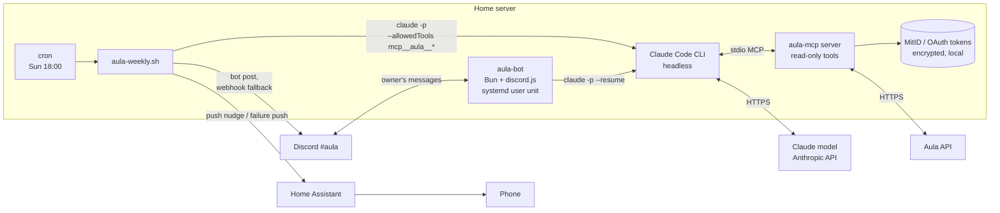

# Blueprint: an AI agent for Aula

How the whole thing works, and how to rebuild it from scratch on any always-on Linux box
(a NUC, a Pi or a small VPS). Everything here is based on the code in `code/`.

## 1. What it does

1. **Sunday digest.** Every Sunday at 18:00 a cron job asks Claude, which only has *read-only*
   Aula tools, "what needs doing this week?". The answer is a short Danish summary in three
   sections (*Skal gøres / Denne uge / Til info*). It's posted to a private Discord channel, and a
   push notification on the phone says "the summary is ready".
2. **Follow-up chat.** In the same Discord channel I can ask questions ("hvornår er der
   forældremøde?"). A small bot runs Claude with the same read-only tools and replies. Follow-ups
   within 30 minutes continue the same conversation.

## 2. Architecture



Three building blocks, each of them replaceable:

| Block | What | Replaceable by |
|---|---|---|
| **Data access** | the open-source aula-mcp server (MIT) exposes Aula as MCP tools | Any MCP server: calendar, email, your kid's sports club |
| **Brain** | Claude Code CLI in headless mode (`claude -p`) | Any MCP-capable client or model |
| **Delivery** | Discord (bot + webhook) and Home Assistant push | Slack, email, Telegram, ntfy |

Where the data goes: credentials and tokens stay on the server (aula-mcp stores them encrypted
locally). The Aula *content* the agent reads is sent to the model provider so it can answer. The
summary ends up in Discord. Choose your client and channel with that in mind.

## 3. Prerequisites

- An always-on Linux machine
- [Bun](https://bun.sh) ≥ 1.3 and [pnpm](https://pnpm.io) ≥ 10 (for aula-mcp), and `python3` + `curl` (for the weekly script)
- [Claude Code](https://claude.com/claude-code), logged in on that machine (`claude` on PATH, typically `~/.local/bin/claude`)
- A Danish MitID with access to Aula as a parent
- A Discord server you own, and optionally Home Assistant with the companion app for push

## 4. Step by step

### 4.1 aula-mcp: give the AI read-only access to Aula

```sh
git clone https://github.com/Casperjuel/aula-mcp.git ~/apps/aula-mcp
cd ~/apps/aula-mcp
pnpm install
pnpm aula login     # MitID QR code. Needs a real terminal. Note: `pnpm aula login`, NOT `pnpm login`
pnpm aula doctor    # health-check every read endpoint
pnpm aula whoami    # shows your identity and the children it can see
```

Register it with Claude Code as a **stdio** server at user scope, so it works from any directory:

```sh
claude mcp add --scope user aula -- bun ~/apps/aula-mcp/packages/mcp-server/src/server-stdio.ts
claude mcp get aula   # → Status: ✔ Connected
```

Use stdio rather than HTTP because the client starts the server process on demand: there's no
port, no daemon and nothing listening. Use the full path to `bun` if PATH is minimal.

Tools are read-only by default (aula-mcp only enables write tools with `AULA_MCP_WRITE`). Leave
that off.

**The discover manifest.** aula-mcp's `aula.discover` returns the children, institutions and the
`detectedWidgets` that your school *actually* has, plus which tool to use per area. The model
should call it once and then pick tools from it. Without that, the model probes integrations the
school doesn't use (see Troubleshooting).

Try it interactively first: `claude` → "hvad skal vi nå i denne uge?".

### 4.2 Configuration and secrets

```sh
mkdir -p ~/.config/aula-agent
cp .env.example ~/.config/aula-agent/env
chmod 600 ~/.config/aula-agent/env
$EDITOR ~/.config/aula-agent/env
```

| Variable | Used by | How to get it |
|---|---|---|
| `DISCORD_BOT_TOKEN` | bot + weekly | Discord Developer Portal → New Application → Bot → Reset Token. **Public Bot: off.** Enable the *Message Content* intent |
| `DISCORD_OWNER_ID` | bot | Discord → Settings → Advanced → Developer Mode, then right-click yourself → Copy User ID |
| `DISCORD_CHANNEL_ID` | bot + weekly | right-click the private channel → Copy Channel ID |
| `DISCORD_WEBHOOK_URL` | weekly (fallback) | Channel → Edit → Integrations → Webhooks |
| `HA_URL`, `HA_NOTIFY_SERVICE`, `HA_TOKEN` | weekly | HA profile → Long-lived access tokens. The service is e.g. `notify/mobile_app_<phone>` |

Invite the bot with the scopes `bot` and permissions *View Channel, Send Messages, Read Message
History, Add Reactions* into a channel only you can see.

### 4.3 The weekly digest (scheduled agent)

`code/weekly/aula-weekly.sh` is the whole agent:

1. Loads the env file.
2. Runs Claude headless with **only** the Aula tools allowed:
   ```sh
   timeout 300 claude -p "$PROMPT" --allowedTools "mcp__aula__*" --output-format text
   ```
3. If it fails or the output is empty: sends a "fejlede" push via HA and exits (a silent
   failure would be worse than none, because you'd assume there was nothing this week).
4. Posts the summary to Discord via the **bot** (REST `POST /channels/{id}/messages`) and falls
   back to the **webhook** if that fails. Messages are capped at 1990 characters (Discord's limit is 2000).
5. Sends a short HA push: "Opsummeringen er klar i Discord".
6. Logs **status and length only**, never the content.

The prompt (Danish, because Aula is Danish and so is the reader):

```
Brug Aula-værktøjerne (kun læsning) til at finde ud af hvad der skal gøres i den kommende uge.
Tjek beskeder, opslag, kalender og ugeplan for de næste 7 dage, samt ubesvarede beskeder.
Svar på dansk, kort og uden indledning, i præcis tre afsnit:
Skal gøres: ting der kræver handling eller svar, med frist.
Denne uge: begivenheder, ting der skal med, udflugter, møder.
Til info: kun hvis vigtigt.
Udelad afsnit uden indhold. Hold samlet svar under 1500 tegn. Brug fed til afsnitsoverskrifter og punktopstilling (Discord-markdown).
```

Prompt design points: a fixed output structure (three named sections), "skip empty sections",
a hard length budget below the channel limit, and the target markup format.

Test, then schedule:

```sh
./code/weekly/aula-weekly.sh --dry-run    # prints the summary, sends nothing
crontab -e
# 0 18 * * 0 /home/you/aula-agent/code/weekly/aula-weekly.sh
```

Cron has a minimal PATH, so the script prepends `~/.local/bin` and `~/.bun/bin`.

### 4.4 The follow-up bot (chat agent)

`code/bot/bot.ts` is about 100 lines of Bun + discord.js:

- **Hard gate:** ignores every message that isn't from `DISCORD_OWNER_ID` in `DISCORD_CHANNEL_ID`,
  and every bot message.
- **One question at a time:** a promise queue serialises requests.
- **Per question:** spawns
  `claude -p <question> --allowedTools mcp__aula__* --append-system-prompt <SYSTEM> --output-format json`
  in a neutral working directory (`/var/tmp/aula-bot-work`), so no project `CLAUDE.md` leaks in.
- **Memory:** stores `session_id` from the JSON output. If the next question arrives within
  30 minutes, it adds `--resume <session_id>`, so "and what about next week?" works.
- **UX:** reacts ⏳ while working, then ✅ or ❌. Long answers are split into 1990-character chunks.
- **Timeout:** kills Claude after 5 minutes.
- **Logs:** `question handled (✅, 42 chars)`, the length only.

System prompt:

```
Du svarer på spørgsmål om Aula (skole/børnehave) via Aula-værktøjerne, som kun kan læse.
Svar på dansk, kort og konkret, med Discord-markdown, under 1800 tegn.
Er noget ikke tilgængeligt, så sig det i stedet for at gætte.
```

The last line matters most. It asks the model to say "I don't know" instead of inventing a field trip.

Run it as a systemd **user** service:

```sh
cd code/bot && bun install
cp ../systemd/aula-bot.service ~/.config/systemd/user/   # adjust paths in the unit
systemctl --user daemon-reload
systemctl --user enable --now aula-bot
sudo loginctl enable-linger "$USER"     # survive logout/reboot without a login session
journalctl --user -u aula-bot -f
```

## 5. Guardrails (the checklist)

| Guardrail | Where |
|---|---|
| Read-only tools only (`--allowedTools "mcp__aula__*"`, aula-mcp write mode off) | weekly + bot |
| No shell, file or web tools for the agent: the allowlist contains nothing else | weekly + bot |
| One user, one channel, private bot (Public Bot off) | bot |
| Secrets in a 600-permission env file, never in code or git | `.env.example` |
| Logs hold status and lengths only, never content | both |
| Failures are loud (push notification), never silent | weekly |
| Timeouts on every model call (300 s) | both |
| Neutral working directory, so no unrelated context is loaded | bot |
| "Say so instead of guessing" in the prompt | bot |

## 6. Troubleshooting

| Symptom | Cause / fix |
|---|---|
| Push says "Aula-opsummering fejlede" | Usually an expired MitID session. `cd ~/apps/aula-mcp && pnpm aula status`, then `pnpm aula login` (needs a real terminal for the QR code) |
| Bot replies "Det lykkedes ikke at hente svaret" | Same as above, or Claude CLI not logged in. Check `journalctl --user -u aula-bot` |
| Summary mentions "Meebook/EasyIQ failed" | The model probed weekly-plan integrations your school doesn't have. Check `detectedWidgets` in `aula.discover`: if your school only has other widgets, there is no *ugeplan* to fetch. Make sure the model calls discover first (aula-mcp's server instructions tell it to) |
| Nothing arrives, no push either | Cron PATH/env: run the script by hand with `--dry-run`, check `code/weekly/logs/aula-weekly.log` |
| Bot online but ignores you | Wrong `DISCORD_OWNER_ID`/`DISCORD_CHANNEL_ID`, or the Message Content intent isn't enabled |
| `pnpm login` shows a QR code | That's npm's own login. Use `pnpm aula login`. Never scan it with MitID |

## 7. Reuse the pattern

The shape (**MCP server for data + headless agent on a schedule + chat bot for follow-ups + push
delivery**) works for any recurring "read a lot, act on a little" chore: the sports club's app,
the housing association's mails, the kindergarten's photo posts, a work inbox digest. Swap the
MCP server and the prompt, and keep the guardrails.

## Credits

- The open-source aula-mcp server (MIT) does all the Aula and MitID work; see §4.1 for where to get it.
  This repo contains none of its code.
