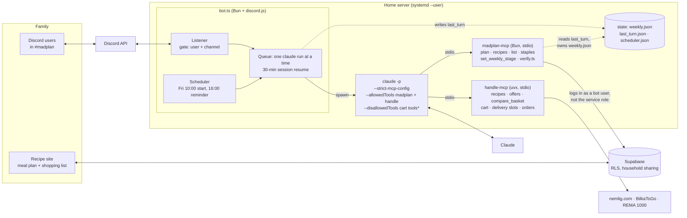
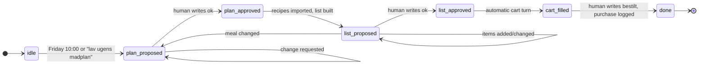

# Blueprint: an AI agent for the weekly meal plan

How the whole thing works, and how to rebuild it on any always-on Linux box (a NUC, a Pi or a
small VPS). Everything here is based on the code in `code/`.

## 1. What it does

1. **Friday 10:00: a plan.** The bot asks Claude for next week's five dinners. Claude may only use
   *store* recipes (nemlig.com and BilkaToGo, via handle-mcp) or the family's own recipes. It
   prices the whole week at nemlig, BilkaToGo and REMA 1000 and posts the plan to `#madplan`.
2. **Humans adjust and approve.** "byt onsdag til noget med fisk", then `ok`.
3. **The shopping list.** The approved recipes are copied into the family's recipe site, their
   ingredients become the shared shopping list, and recurring items ("Faste varer": milk, skyr …)
   are added based on how fast the family uses them. Humans adjust ("bryst i stedet for lår",
   "tilføj bleer") and write `ok`.
4. **The cart.** The bot prices the final list again and fills the cheapest store's cart. It
   posts the total, what the other stores would have cost, and the three best delivery or
   pickup times.
5. **The human pays.** They pick a time and pay on the store's site, then write `bestilt`. The bot
   reads the order back and logs the purchase, which teaches it the family's consumption rates.

At 16:00 on Friday it sends a reminder if a step is still waiting for an `ok`. Outside the Friday
flow, `#madplan` is a normal chat: "hvad skal vi have i aften?", "ingen aftensmad fredag",
"gem opskriften" (save a recipe you just pasted), "vi drikker 3 l mælk på 3 dage".

## 2. Architecture



\* The cart-changing tools are only allowed in the dedicated cart turn, and outside the Friday flow.

| Block | What | Replaceable by |
|---|---|---|
| **Store access** | [handle-mcp](https://github.com/NJohansen/handle-mcp) (MIT): recipes, offers, basket comparison, cart, delivery slots, orders | Any shop with an MCP server |
| **Family data** | `madplan-mcp`: meal plan, own recipes, shopping list, staples, the weekly state machine | Any database you own; SQLite works too |
| **Brain** | Claude Code CLI in headless mode (`claude -p`) | Any MCP-capable client or model |
| **Interface** | Discord bot | Slack, Telegram, Matrix |

**Where the data goes:** store logins live with handle-mcp on the server, and Supabase credentials
live in a 600-permission env file. Recipes, the plan and the shopping list are sent to the model
provider so it can work with them. The plan and list end up in Discord and on the recipe site.

## 3. The weekly flow is a state machine



The state lives in `~/.local/state/madplan/weekly.json`, and **only the MCP tool
`set_weekly_stage` writes it**. That tool is where the rules are enforced (§5).

### Tables the MCP server expects (Supabase / Postgres)

The recipe site's migrations aren't in this repo, but this is what `server.ts` reads and writes:

| Table | Used columns |
|---|---|
| `recipes` | `id, title, slug, description, instructions (text[]), servings, prep_time, cook_time, image_url, author_id, type, source, external_id, source_url, is_favorite`; unique on `(source, external_id)` |
| `ingredients` | `recipe_id, name, amount, unit, notes, position` |
| `tags`, `recipe_tags` | `id, name, category` / `recipe_id, tag_id` |
| `meal_plans` | `id, user_id, date, recipe_id (nullable), title, source (opskrifter/nemlig/bilkatogo/rema1000/fri/ingen), external_id, source_url, servings, notes` |
| `shopping_lists`, `shopping_list_items` | `id, user_id, name` / `id, shopping_list_id, name, amount, unit, position, is_checked` |
| `households`, `household_members` | RLS shares plans, lists and recipes within a household |
| `staples` | `household_id, name, unit, seed_quantity, seed_days, learned_per_day, learned_at, preferred_product, active`; unique on `(household_id, name)` |
| `purchases` | `household_id, purchased_on, store, order_id, product_name, product_id, packs, quantity, unit, price, staple_id` |
| `profiles` | `id, name` (to show who added a meal) |

## 4. Step by step

### 4.1 handle-mcp: give the AI the grocery stores

```sh
uvx handle-mcp@latest login nemlig        # and/or bilkatogo, rema1000
claude mcp add handle -- uvx handle-mcp@latest
```

In Claude Code, ask "Hvad er på tilbud i denne uge?" to check it works. handle-mcp **cannot order or
pay**: that code doesn't exist, and a test fails if it shows up (its ADR 0001, "the human always
pays"). At REMA 1000 the "cart" is a shopping list called `handle-mcp` in REMA's app.

### 4.2 madplan-mcp: the family's own data

1. Create a dedicated auth user for the bot in your Supabase project and add it to the household.
   Use the **anon/publishable key** plus that user, never the service-role key, so Row Level
   Security applies to everything the agent does.
2. Configure secrets:
   ```sh
   mkdir -p ~/.config/madplan-agent
   cp .env.example ~/.config/madplan-agent/env && chmod 600 ~/.config/madplan-agent/env
   $EDITOR ~/.config/madplan-agent/env
   ```
3. Install and test:
   ```sh
   cd code/madplan-mcp && bun install && bun test
   ```

### 4.3 The bot

```sh
cd code/bot && bun install
cp mcp.example.json mcp.json                                   # fix the paths
cp config.example.json ~/.config/madplan-agent/config.json     # your users, rules, stores
cp ../systemd/madplan-bot.service ~/.config/systemd/user/      # fix the paths
systemctl --user daemon-reload && systemctl --user enable --now madplan-bot
sudo loginctl enable-linger "$USER"
journalctl --user -u madplan-bot -f
```

Discord: Developer Portal → New Application → Bot → token into the env file. **Public Bot: off.**
Enable the *Message Content* intent. Invite it with *View Channel, Send Messages, Read Message
History, Embed Links, Add Reactions*. Write in the channel. Unknown users are ignored, and their
id is logged so you can add them to `users` in the config (re-read on every message, no restart).

Each run is:

```sh
claude -p "<status line + message>" \
  --mcp-config mcp.json --strict-mcp-config \
  --allowedTools 'mcp__madplan__*' 'mcp__handle__*' \
  --disallowedTools mcp__handle__set_cart_quantities mcp__handle__add_recipe_to_cart \  # except in the cart turn
  --append-system-prompt "<family rules>" --output-format json [--resume <session>]
```

`--strict-mcp-config` means the agent loads **only** these two servers, even if the machine has
others registered (a bank, a school platform …). The working directory is a neutral
`/var/tmp/madplan-bot-work`, so no project `CLAUDE.md` leaks in.

Dry-run the prompts without Discord: `bun bot.ts --print-prompts /tmp/prompts`.

## 5. Guardrails: prompts ask, code decides

The system prompt *asks* for all of the below. None of them depends on the model obeying:

| Rule | Enforced where |
|---|---|
| **Never invent recipes.** Every weekday must be a store recipe with an id/link from handle, or an own recipe | `checkWeekPlan` in `set_weekly_stage`: the flow can't move to `plan_*`/`list_proposed` otherwise |
| **Only humans approve.** | `bot.ts` (code, not Claude) writes `last_turn.json` with `kind: human` or `system` before each run. `*_approved` stages are refused unless it says `human` |
| **No skipping steps.** | `set_weekly_stage` refuses jumps (e.g. `plan_proposed` → `list_approved`) |
| **No cart changes during the flow** except in the cart turn | `--disallowedTools` on every other run |
| **Never order or pay.** | handle-mcp has no such code |
| **"No dinner" is an honest exit, not a loophole.** | `mark_no_dinner` only works in a human turn, so the agent can't mark a day to get past the recipe check |
| **Saving a recipe from chat** only on an explicit command, and only the human's own words | `bot.ts` detects the trigger phrase and collects only that user's own recent messages. `import_user_recipe` refuses without it, after 15 min, after one use, or if any title/ingredient/amount/step isn't in that text (`verify.ts`) |
| **Database access is a normal user** | RLS: the bot sees only what the household shares |
| **Only listed people, one channel** | `users` + `channel_name` in the config |
| **Logs hold status and lengths, never content** | `bot.ts` |

## 6. Learning what the family buys

Each staple has a **told** rate ("3 l mælk på 3–4 dage") and, once there's enough data, a
**learned** rate. After `bestilt`, the bot reads the actual order (`get_orders`/`get_order` on
nemlig and BilkaToGo; for REMA it logs the cart) and calls `log_purchase`. The learned rate needs
at least three purchase days spanning at least 14 days:
`rate = everything bought before the last purchase day ÷ days between first and last`.
Next week's suggestion = `rate × 7 − estimated leftover`, rounded up to whole packs.

## 7. Troubleshooting

| Symptom | Cause / fix |
|---|---|
| "Plan not valid: fredag … no store recipe" | A weekday has a free-text meal. Replace it, or write "ingen aftensmad fredag" if nobody is eating |
| "Approval refused" | The agent tried to approve in a system turn. A human has to write `ok` |
| Cart step fails | Usually an expired store login: `uvx handle-mcp@latest login <store>`. Then write "prøv kurven igen" |
| "Opskriften blev ikke gemt" | The model tried to save something not in your text (e.g. "3½" turned into 3.5). It retries; if it still fails, write the amount plainly |
| Bot ignores someone | Their Discord id isn't in `users`. Check the journal for the logged id |

## 8. Known limits

- The recipe check is a containment check on normalised text. Amounts are matched as substrings,
  so `50` is "found" inside `500 g` (see the `test.todo` in `verify.test.ts`).
- REMA 1000 has no recipes and no readable order history, so it only competes on price, and
  purchases there are logged from the cart.
- The price comparison is only as good as the product matching. Ambiguous items (`"sure": false`)
  are named in the message so a human can check them.

## Credits

- [handle-mcp](https://github.com/NJohansen/handle-mcp) (MIT) does all the store work. This repo
  contains none of its code.
